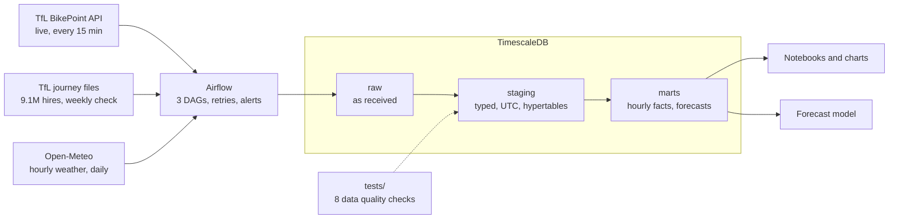

# London Bike Dock Pipeline

An end-to-end data pipeline for London's Santander Cycles: **9 million hires, a year of hourly weather and live dock status**, loaded into TimescaleDB, orchestrated with Airflow, tested automatically, and turned into two findings an operations team could act on.

## Findings

**1. Rain cuts bike hires by about 28%, and heavier rain cuts more.**
On working days, an hour with more than 0.5 mm of rain has about 28% fewer hires than a dry hour at the same time of day in the same month: −13% in drizzle, −35% in heavy rain.


**2. Morning demand can be forecast well per area, not per dock-hour.**
A day-ahead forecast of each area's working-day morning rush (07:00–09:59) is off by 12%, against 18% for simple guesses, 31% more accurate. For a single dock in a single hour, hires are mostly chance, and the dock's usual pattern is about as good as any model.


**Recommendations**
- **Plan rebalancing vans by area, the evening before,** then share bikes out within each area using each dock's usual pattern.
- **Test a rain discount** aimed at midday, where rain cuts the most hires, not the 07:00 commute, where most riders come anyway. The data shows the demand to win back; a pilot would show whether a discount wins it.

Full write-up with methods and limits: [docs/findings.md](docs/findings.md)

## Architecture



- **raw** keeps every response exactly as received, so anything downstream can be rebuilt.
- **staging** applies types, converts London time to UTC, cleans names and matches journeys to docks.
- **marts** hold the answers: hires per hour with weather, and hires per dock per hour with lag features.

## What's inside

| Area | What I built |
| --- | --- |
| Extract | Three Python extractors with retries, exponential backoff, timeouts and secrets kept in `.env` ([src/extract](src/extract)) |
| Load | Raw, staging and marts schemas; TimescaleDB hypertables; idempotent, incremental loads ([sql](sql)) |
| Transform | SQL with CTEs, window functions (`LAG`, `ROW_NUMBER`), `time_bucket`, materialized views |
| Orchestrate | Airflow DAGs every 15 minutes, daily and weekly, with retries and phone alerts on failure ([dags](dags)) |
| Data quality | 8 automated SQL tests: freshness, volume, validity, schema and match rate ([tests](tests)) |
| Analysis | A like-for-like rain comparison, and a forecast tested on an unseen month against 4 baselines ([src/analysis](src/analysis)) |
| Documentation | Project brief, data issues log and findings ([docs](docs)) |

## Data issues I found and fixed

Real data was messy. Each issue is written up with the evidence, the cause and the fix in [docs/data_issues.md](docs/data_issues.md):

1. **Bike counts that don't add up:** at 81% of docks, bikes plus free spaces is less than the dock size. I tested and ruled out two explanations; the gaps behave like broken docking points.
2. **Messy station names,** such as `Dunston Road , Haggerston`.
3. **A 17-hour collector outage** nobody was told about, which led to the freshness test and Airflow alerts.
4. **Reused station numbers:** TfL reused 3 terminal numbers for docks elsewhere in London, which would have put about 19,500 journeys at the wrong dock. Journeys now match on number and name.
5. **Impossible hire durations:** 77,000 hires under a minute, over a day, or ending before they start.

## Run it yourself

Requires Docker Desktop and Python 3.13 on Windows.

```powershell
git clone https://github.com/dudechillapp/london-bike-dock-pipeline.git
cd london-bike-dock-pipeline
copy .env.example .env                  # then set DB_PASSWORD, and the same password in WAREHOUSE_URL

py -3.13 -m venv .venv
.venv\Scripts\activate
pip install -r requirements.txt

.\scripts\build_warehouse.ps1           # builds everything, about 15-25 minutes
docker compose up -d                    # starts Airflow at http://localhost:8080
docker logs bikes-airflow 2>&1 | Select-String "password"   # login for user admin
```

## Stack

Python 3.13 · SQL · TimescaleDB (PostgreSQL 16) · Apache Airflow 2.10 · Docker · pandas · scikit-learn · matplotlib

## Data sources

- [TfL BikePoint API](https://api.tfl.gov.uk/BikePoint) and [TfL cycling journey data](https://cycling.data.tfl.gov.uk/). Powered by TfL Open Data.
- [Open-Meteo](https://open-meteo.com/) historical and recent weather (CC BY 4.0).

## Next

- An **MCP (Model Context Protocol) server**, so an AI agent can answer questions such as "Which areas will be busiest tomorrow morning?" from the marts, with read-only access.
- **Empty-dock minutes** per dock from the live collector, once it has a few weeks of weekday mornings.
- Weather **forecasts** instead of actual weather as model inputs, for a true day-ahead forecast.
