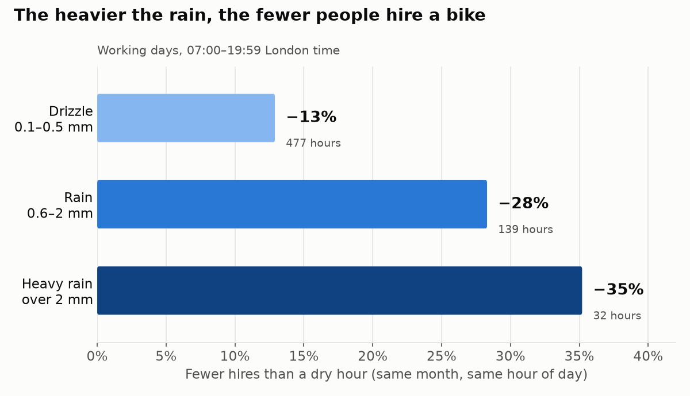
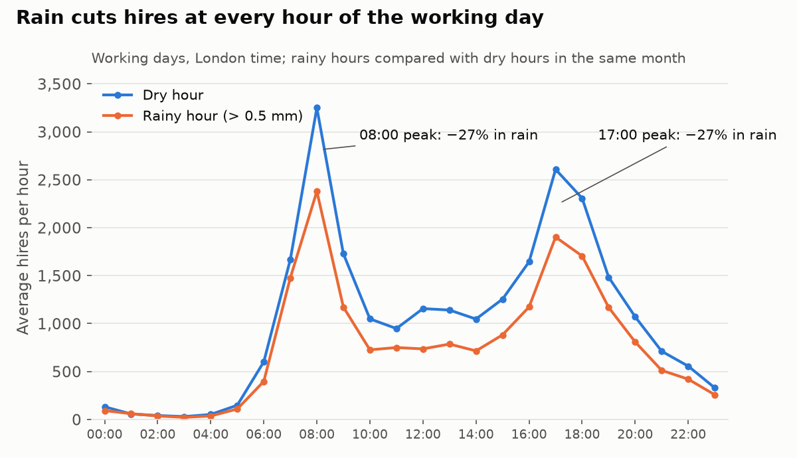
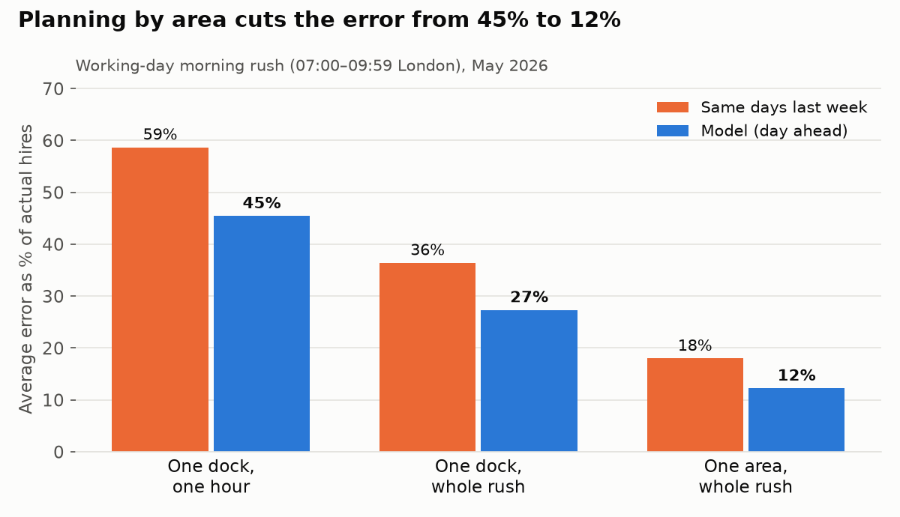
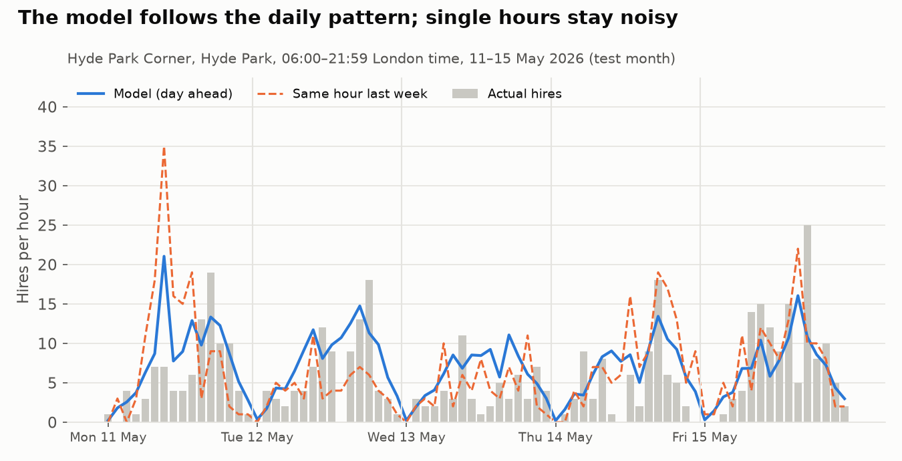

# Findings

What the data shows so far, with the evidence behind each result.
Data: 9,015,474 valid Santander Cycles hires (June 2025 to May 2026) joined to hourly London weather.

| # | Finding |
| --- | --- |
| 1 | Rain cuts hires by about 28%, and heavier rain cuts more |
| 2 | A day-ahead forecast of morning demand per area is 31% more accurate than simple guesses; single dock-hours are mostly chance |

---

## Finding 1: Rain cuts hires by about 28%, and heavier rain cuts more

**On working days, an hour with more than 0.5 mm of rain has about 28% fewer hires than a dry hour at the same time of day in the same month.**

| Rain in the hour | Hires compared with a dry hour | Hours of data |
| --- | --- | --- |
| Drizzle (0.1–0.5 mm) | −13% | 477 |
| Rain (0.6–2 mm) | −28% | 139 |
| Heavy rain (over 2 mm) | −35% | 32 |

The steady step from drizzle to heavy rain is the strongest evidence here: a real effect gets bigger as the cause gets bigger.

### When rain matters most

- **Both commuter peaks drop by about 27%** in rain (08:00 and 17:00).
- **07:00 drops only about 12%.** The earliest commuters seem to ride anyway.
- **Midday and early afternoon drop the most, about 30–36%.** Those trips are more optional, so rain puts people off more easily.

### How I measured it
- **Rain** means more than 0.5 mm in the hour, the definition from the [project brief](project_brief.md).
- **Like with like:** each rainy hour is compared with dry hours in the same month, at the same hour of the day, on the same kind of day (working day or not). Otherwise rain would also pick up the effect of winter and night-time, when fewer people ride anyway.
- **Working days** are Monday to Friday, excluding England bank holidays.
- **Valid trips only:** 1 minute to 1 day, ending after they start (see [data issue 5](data_issues.md)).

A simpler comparison of all rainy hours against all dry hours gives 26.8%, close to the 27.8% above. So in London, season and time of day barely distort the rain effect. I checked rather than assumed it.

### Limits
- **Rainy hours are rare.** Only 340 hours in the year had more than 0.5 mm, so each hour of the day has just 5 to 19 rainy hours behind it. The overall figure is solid; the hour-by-hour figures are signals, not facts.
- **Heavy rain has only 32 hours of data.** −35% is a direction, not a precise number.
- **The weather is one point in central London.** Outer areas may have had different rain in the same hour.
- **This is correlation.** Rain often comes with wind and cold. I haven't yet separated those effects.

---

## Recommendation to test: a rain discount

**My suggestion:** make hires cheaper when it rains, scaled to how heavy the rain is, to win back some of the riders rain puts off.

**What the data supports**
- There is real demand to win back: 13% to 35% of hires are lost in rain, depending on how heavy it is.
- Where to aim it: **midday and early afternoon**, where rain cuts the most hires (about 30–36%) and the bikes are least busy anyway.
- Where not to: **the 07:00 commute**, where most riders come anyway. A discount there would mostly give money to people who'd have paid full price.

**What the data can't tell us yet**
This data has no prices, so it can't show whether a discount would actually bring riders back, or how much revenue it would cost. That needs a test:
1. Run a pilot: a rain discount on some days or in some areas, and normal prices on the others.
2. Compare hires in rainy hours between the two groups.
3. Check that the extra hires are worth more than the discount given to riders who would have come anyway.

**A question for operations:** with about 27% fewer hires on wet mornings, do the usual problem docks still run empty? If not, a rain forecast could let the rebalancing team send fewer vans. My live dock data will answer this once it covers some rainy mornings.

---

## Finding 2: Hires can be forecast well for an area, not for a single dock-hour

**A day-ahead forecast of the working-day morning rush (07:00–09:59) is off by 12% per area, against 18% for the simple guesses, a 31% improvement. For a single dock in a single hour, nothing does much better than the dock's usual pattern.**

Tested on May 2026, a month the model never saw while training (June 2025 to April 2026).

| Level | Average hires | Same days last week | Dock's usual level | Model (day ahead) | Model vs best simple guess |
| --- | --- | --- | --- | --- | --- |
| One dock, one hour (all hours) | 1.45 | 1.19 | 0.92 | 0.92 | +0.2% |
| One dock, one hour (morning rush) | 3.05 | 1.79 | 1.44 | 1.39 | +3.5% |
| One dock, whole morning rush | 9.2 | 3.33 | 2.76 | **2.50** | **+9.4%** |
| One area, whole morning rush | 58.7 | 10.55 | 10.47 | **7.18** | **+31.4%** |

Numbers in the forecast columns are MAE (Mean Absolute Error): the average number of hires the forecast is off by. Lower is better.

### What it means
1. **A single dock-hour is mostly chance.** A dock averages 1.45 hires an hour and 48% of dock-hours have none. Even a perfect estimate of the rate would still be off by about 0.74 hires on average (0.92 for the model), just because riders turn up at random.
2. **The dock's usual pattern does most of the work.** It is 23% more accurate than "same hour last week", the obvious guess. The model adds only 0.2–3.5% at this level.
3. **Adding up hours and docks is where the model earns its place.** Chance variation cancels out in totals, while the things the model knows about (season, weather, bank holidays, recent demand) don't. At area level it beats the simple guesses by 31%.
4. **Last week is a bad guide after a bank holiday.** In the chart below, "same hour last week" shoots up on Monday 11 May, copying the leisure rush of the Early May bank holiday on 4 May. The model knows it's a normal working day.

### Recommendation
- **Plan vans by area, the evening before:** forecast each area's morning-rush demand. In Waterloo, the busiest area, May averaged 373 morning-rush hires a day, forecast at 348, with an average miss of 54 (14%).
- **Share bikes out within an area using each dock's usual pattern.** It's simple, explainable and nearly as accurate as a model at dock level.

### How I built it
- `marts.dock_hourly_hires`: one row per dock per hour (about 6.8 million), including hours with 0 hires, with lagged hires from `LAG()` window functions.
- A gradient boosting model for counts (scikit-learn `HistGradientBoostingRegressor`, Poisson loss), using the hour, day, bank holidays, weather, recent hires and each dock's usual level. The dock's usual level is learned from training months only, so nothing leaks from May.
- Areas are the part of each dock name after the last comma, for example "Waterloo": 124 areas.

### Limits
- **The weather inputs are the actual weather.** In real use the model would get tomorrow's weather forecast, so real errors would be a little higher.
- **One test month.** May has two bank holidays and long, light evenings; a winter month could look different.
- **Hires aren't empty docks.** This forecasts demand. Whether a dock actually runs empty also depends on returns and van moves, which the live collector covers.
- **The model predicts averages, while MAE rewards the most likely value.** Part of the gap to the "perfect rate" figure (0.92 against 0.74) comes from that, not just from missing information.

---

_Reproduce Finding 1: `python -m src.analysis.rain_effect` and `python -m src.analysis.rain_charts`._
_Reproduce Finding 2: `python -m src.analysis.forecast_hires`, then `python -m src.analysis.forecast_windows` and `python -m src.analysis.forecast_charts`._
